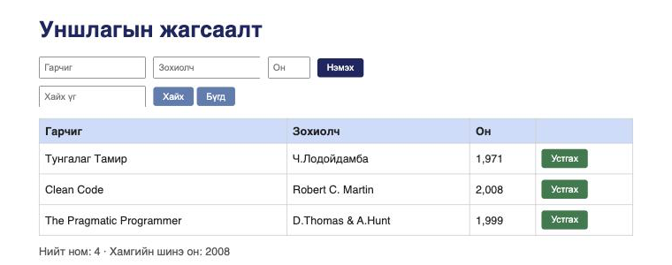

# BUG-01: «Нийт ном» тоолуур хүснэгтийн мөрийн тооноос үргэлж 1-ээр их харагдана

**Орчин:** Уншлагын жагсаалт v2.0, Chromium 152.0.7977.149 (Claude desktop built-in browser), macOS 26.6.2, node v20.20.2, 2026-10-17
**Урьдчилсан нөхцөл:** `node app.js`-ийг шинээр асаасан (анхны 3 ном), браузерт http://localhost:3000 нээсэн

## Дахин гаргах алхам

1. http://localhost:3000 хуудсыг нээнэ.
2. Хүснэгтэд байгаа номын мөрийг тоолно (3 мөр: Тунгалаг Тамир, Clean Code, The Pragmatic Programmer).
3. Хүснэгтийн доорх «Нийт ном: …» текстийг уншина.
4. (Нэмэлт) Clean Code мөрийн «Устгах» товчийг дарна — хүснэгтэд 2 мөр үлдэнэ, тоолуурыг дахин уншина.

**Хүлээгдэж байсан:** Спецификаци — «Нийт ном» тоолуур хүснэгтэд буй номын тоотой тэнцүү, өөрөөр хэлбэл «Нийт ном: 3» (4-р алхмын дараа «Нийт ном: 2»).

**Бодит үр дүн:** «Нийт ном: 4 · Хамгийн шинэ он: 2008» гэж харагдана. 4-р алхмын дараа «Нийт ном: 3». Ном нэмэх/устгах бүрт тоолуур мөрийн тооноос байнга 1-ээр их байна. Хайлтын үед (ж: «clean» хайхад 0 мөр) ч тоолуур «4» хэвээр.

**Ноцтой байдал:** Major — апп-ын гол хураангуй мэдээлэл үргэлж худал тоо харуулж, хэрэглэгчийг төөрөгдүүлнэ; workaround байхгүй.

**Хавсралт:** screenshots/bug-01.png

**Олдсон аялал:** Supermodel (GUI-ийн гадаргууг ажиглах)
