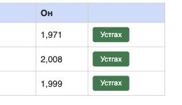

# BUG-02: Хүснэгтийн «Он» баганад он мянгатын таслалтай («1,971») харагдана

**Орчин:** Уншлагын жагсаалт v2.0, Chromium 152.0.7977.149 (Claude desktop built-in browser), macOS 26.6.2, node v20.20.2, 2026-10-17
**Урьдчилсан нөхцөл:** `node app.js`-ийг шинээр асаасан (анхны 3 ном), браузерт http://localhost:3000 нээсэн

## Дахин гаргах алхам

1. http://localhost:3000 хуудсыг нээнэ.
2. Хүснэгтийн «Он» баганыг харна.

**Хүлээгдэж байсан:** Спецификаци — «Он нь 1000-2100 хоорондох бүхэл тоо; хүснэгтэд энгийн тоогоор (жишээ нь 1999) харагдана.» → 1971, 2008, 1999.

**Бодит үр дүн:** «1,971», «2,008», «1,999» гэж мянгатын тусгаарлагч таслалтай харагдана. Шинээр нэмсэн ном ч мөн адил (ж: 1940 → «1,940»). «Хамгийн шинэ он: 2008» текст харин зөв, таслалгүй — нэг апп дотор хоёр өөр формат.

**Ноцтой байдал:** Minor — өгөгдөл зөв хадгалагдаж байгаа (`GET /api/books` → `"year":1971`) ч дэлгэцэнд он биш тоо ширхэг мэт буруу харагдана.

**Хавсралт:** screenshots/bug-02.png

**Олдсон аялал:** Supermodel
