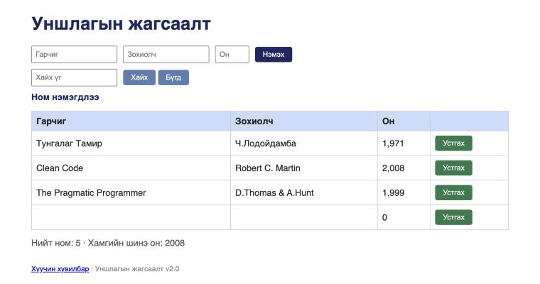

# BUG-05: Гарчиг/Зохиолч/Он хоосон байхад «Нэмэx» дарахад алдааны мессежгүйгээр хоосон ном нэмэгдэнэ

**Орчин:** Уншлагын жагсаалт v2.0, Chromium 152.0.7977.149 (Claude desktop built-in browser), macOS 26.6.2, node v20.20.2, 2026-10-17
**Урьдчилсан нөхцөл:** `node app.js`-ийг шинээр асаасан (анхны 3 ном), браузерт http://localhost:3000 нээсэн

## Дахин гаргах алхам

1. Гарчиг, Зохиолч, Он талбаруудыг бүгдийг нь хоосон үлдээнэ.
2. «Нэмэx» товчийг дарна.
3. (Хувилбар) Аппыг дахин асааж, зөвхөн Гарчиг = `Шинэ ном` бичээд Зохиолч, Он-г хоосон үлдээж «Нэмэx» дарна.
4. (API) `curl -i -X POST localhost:3000/api/books -H 'Content-Type: application/json' -d '{}'`

**Хүлээгдэж байсан:** Спецификаци — «Ном нэмэхэд Гарчиг, Зохиолч, Он гурван талбар бүгд заавал бөглөгдсөн байх ёстой; дутуу бол ном нэмэгдэхгүй, ойлгомжтой алдааны мессеж харагдана.» API нь 400 буцаах ёстой.

**Бодит үр дүн:** 2-р алхамд «Ном нэмэгдлээ» мессеж гарч, Гарчиг, Зохиолч хоосон, Он = «0» бүхий 4-р мөр хүснэгтэд нэмэгдэнэ; «Нийт ном: 5». 3-р алхамд Зохиолч, Он хоосон «Шинэ ном» нэмэгдэнэ. 4-р алхамд `HTTP/1.1 201 Created`, `{"result":"OK","id":4}` — `GET /api/books`-д `{"id":4,"title":"","author":""}` хадгалагдсан. Нэг шалтгаан (заавал талбарын шалгалт байхгүй) — UI ба API хоёуланд.

**Ноцтой байдал:** Major — өгөгдлийн бүрэн бүтэн байдал алдагдана (утгагүй хоосон бичлэг), хэрэглэгчид ямар ч сануулга өгөхгүй.

**Хавсралт:** screenshots/bug-05.png · evidence/bug-05-curl.txt

**Олдсон аялал:** Couch Potato (хоосон оролт)
