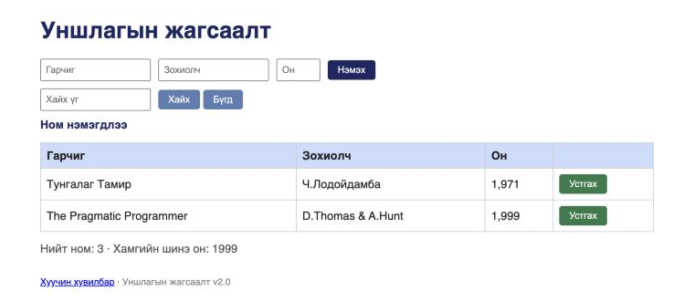

# BUG-06: Ном устгасны дараа «Ном нэмэгдлээ» гэсэн буруу мессеж гарна

**Орчин:** Уншлагын жагсаалт v2.0, Chromium 152.0.7977.149 (Claude desktop built-in browser), macOS 26.6.2, node v20.20.2, 2026-10-17
**Урьдчилсан нөхцөл:** `node app.js`-ийг шинээр асаасан (анхны 3 ном), браузерт http://localhost:3000 нээсэн

## Дахин гаргах алхам

1. «Clean Code» мөрийн «Устгах» товчийг дарна.
2. Хайлтын мөрийн доор гарах мессежийг уншина.

**Хүлээгдэж байсан:** Спецификаци — «Үйлдэл бүрийн дараах мессеж тухайн үйлдэлдээ тохирно» → жишээ нь «Ном устгагдлаа».

**Бодит үр дүн:** «Clean Code» мөр хүснэгтээс алга болж (2 мөр үлдэнэ) байхад мессеж «Ном нэмэгдлээ» гэж гарна. Хэрэглэгч ном нэмэгдсэн гэж ойлгоно.

**Ноцтой байдал:** Minor — үйлдэл зөв гүйцэтгэгдэнэ, гэхдээ санал хүсэлт (feedback) худал тул хэрэглэгчийг төөрөгдүүлнэ.

**Хавсралт:** screenshots/bug-06.png

**Олдсон аялал:** FedEx (нэмсэн → устгасан өгөгдлийн замыг мөшгих)
