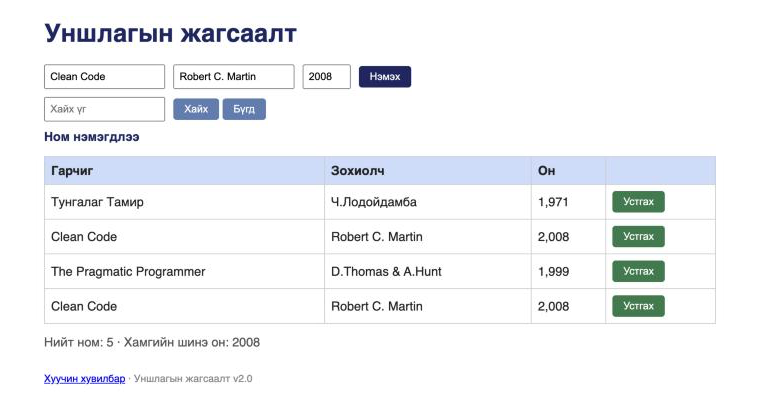

# BUG-08: Ижил гарчиг, зохиолчтой ном давхардаж нэмэгдэнэ

**Орчин:** Уншлагын жагсаалт v2.0, Chromium 152.0.7977.149 (Claude desktop built-in browser), macOS 26.6.2, node v20.20.2, 2026-10-17
**Урьдчилсан нөхцөл:** `node app.js`-ийг шинээр асаасан (анхны 3 ном), браузерт http://localhost:3000 нээсэн

## Дахин гаргах алхам

1. Гарчиг = `Clean Code`, Зохиолч = `Robert C. Martin`, Он = `2008` гэж бичнэ.
2. «Нэмэx» товчийг дарна.

**Хүлээгдэж байсан:** Спецификаци — «Ижил гарчиг, зохиолчтой ном давхардуулж нэмэгдэхгүй» → «Clean Code» аль хэдийн байгаа тул нэмэгдэхгүй, «ийм ном байна» төрлийн мессеж.

**Бодит үр дүн:** «Ном нэмэгдлээ» мессеж гарч, хүснэгтэд яг ижил «Clean Code | Robert C. Martin | 2,008» хоёр мөр болно. API-аар илгээхэд мөн `HTTP/1.1 201 Created`, `?q=Clean` хайлт 2 бичлэг буцаана (evidence/bug-08-curl.txt).

**Ноцтой байдал:** Major — давхардсан өгөгдөл үүсч, тоолуур, хайлтын үр дүн хэрэгцээгүй өснө; спецификацийн тодорхой дүрэм зөрчигдөж байна.

**Хавсралт:** screenshots/bug-08.png · evidence/bug-08-curl.txt

**Олдсон аялал:** Saboteur (curl-ээр анх олсон) → FedEx (UI-аар баталсан)
