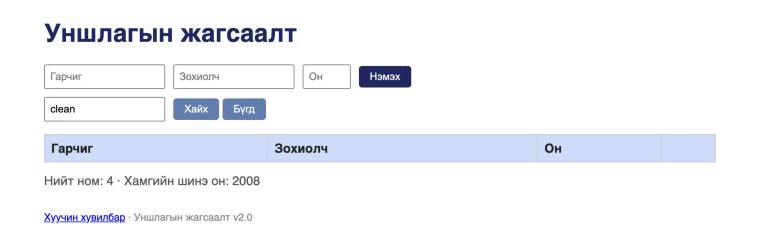
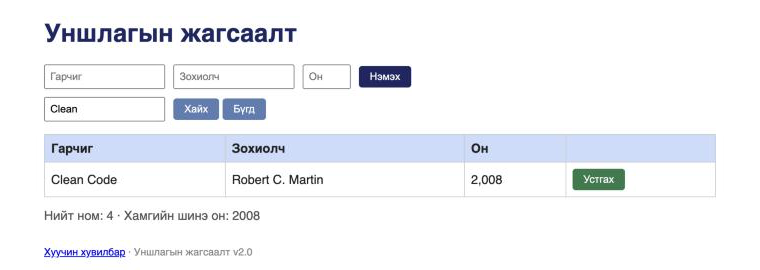

# BUG-09: Хайлт том/жижиг үсэг ялгадаг — «clean» хайхад «Clean Code» олдохгүй

**Орчин:** Уншлагын жагсаалт v2.0, Chromium 152.0.7977.149 (Claude desktop built-in browser), macOS 26.6.2, node v20.20.2, 2026-10-17
**Урьдчилсан нөхцөл:** `node app.js`-ийг шинээр асаасан (анхны 3 ном), браузерт http://localhost:3000 нээсэн

## Дахин гаргах алхам

1. «Хайх үг» талбарт `clean` (бүгд жижиг үсэг) гэж бичнэ.
2. «Хайх» товчийг дарна.
3. «Хайх үг» талбарын бичвэрийг бүгдийг сонгож `Clean` гэж бичээд «Хайх» дарна.

**Хүлээгдэж байсан:** Спецификаци — «Хайлт гарчиг болон зохиолчоос хайх ба том/жижиг үсэг ЯЛГАХГҮЙ» → 1 болон 3-р алхам хоёулаа «Clean Code» мөрийг харуулна.

**Бодит үр дүн:** 2-р алхамд хүснэгт хоосон (зөвхөн толгой мөр), 3-р алхамд «Clean Code» гарна. Зохиолчоор: `martin` → хоосон, `Martin` → олдоно. API `?q=clean` → `[]`, `?q=Clean` → 1 бичлэг (evidence/bug-09-curl.txt).

**Ноцтой байдал:** Major — гол функц (хайлт) хэрэглэгчийн хамгийн түгээмэл бичдэг хэлбэрт (жижиг үсэг) ажиллахгүй.

**Хавсралт:** screenshots/bug-09.png (`clean`) · screenshots/bug-09-b.png (`Clean`) · evidence/bug-09-curl.txt

**Олдсон аялал:** Saboteur (API query-ээр анх) → Supermodel/FedEx (UI-аар баталсан)
