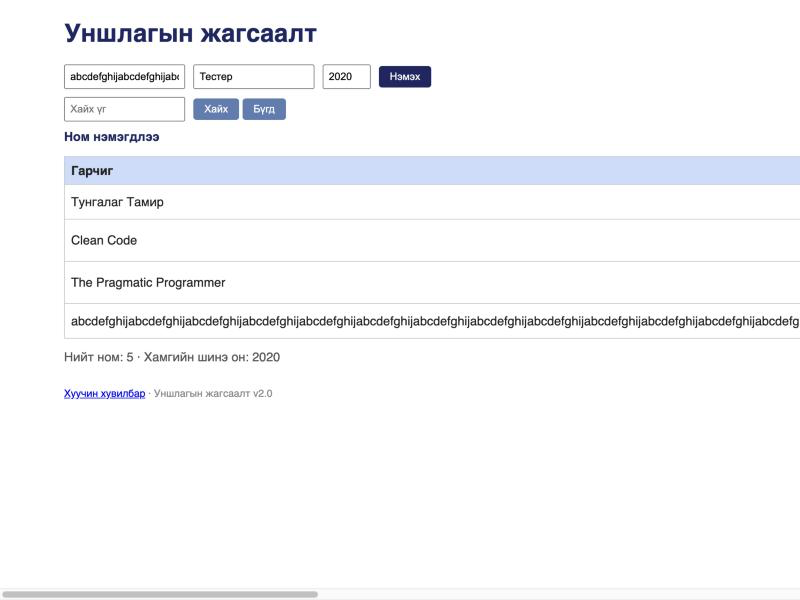

# BUG-12: Зайгүй урт гарчигтай ном нэмэхэд хүснэгт дэлгэцээс хальж, Зохиолч/Он/Устгах баганууд харагдахгүй болно

**Орчин:** Уншлагын жагсаалт v2.0, Chromium 152.0.7977.149 (Claude desktop built-in browser), macOS 26.6.2, node v20.20.2, 2026-10-17
**Урьдчилсан нөхцөл:** `node app.js`-ийг шинээр асаасан (анхны 3 ном), браузерт http://localhost:3000 нээсэн, цонхны өргөн 1024px

## Дахин гаргах алхам

1. Гарчиг талбарт дараах 300 тэмдэгттэй, зайгүй мөрийг хуулж тавина:
   ```text
   abcdefghijabcdefghijabcdefghijabcdefghijabcdefghijabcdefghijabcdefghijabcdefghijabcdefghijabcdefghijabcdefghijabcdefghijabcdefghijabcdefghijabcdefghijabcdefghijabcdefghijabcdefghijabcdefghijabcdefghijabcdefghijabcdefghijabcdefghijabcdefghijabcdefghijabcdefghijabcdefghijabcdefghijabcdefghijabcdefghij
   ```
2. Зохиолч = `Тестер`, Он = `2020` гээд «Нэмэx» дарна.

**Хүлээгдэж байсан:** Спецификаци — «хүснэгт ямар ч урттай оролтод эвдрэхгүй» → урт текст мөр шилжиж (wrap) эсвэл тасалж (ellipsis) харагдаж, бүх багана дэлгэцэнд үлдэнэ.

**Бодит үр дүн:** Хүснэгтийн өргөн ≈2474px болж (цонх 1024px), Зохиолч, Он, «Устгах» баганууд бүх мөрөнд дэлгэцээс гарч хэвтээ гүйлгэгч (scrollbar) гарч ирнэ. Анхны 3 номын «Устгах» товч ч харагдахгүй.

**Ноцтой байдал:** Minor — өгөгдөл алдагдахгүй, гэхдээ ганц урт оролт бүх хүснэгтийн хэрэглээг эвдэнэ (Устгах товч харагдахгүй).

**Хавсралт:** screenshots/bug-12.png



**Олдсон аялал:** Antisocial (хэт урт оролт)
