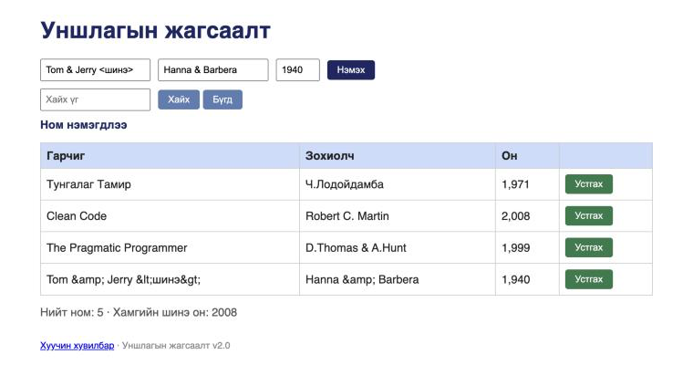

# BUG-13: Гарчиг/Зохиолч дахь «&», «<», «>» тэмдэгт хүснэгтэд «&amp;», «&lt;», «&gt;» гэж давхар escape хийгдэж харагдана

**Орчин:** Уншлагын жагсаалт v2.0, Chromium 152.0.7977.149 (Claude desktop built-in browser), macOS 26.6.2, node v20.20.2, 2026-10-17
**Урьдчилсан нөхцөл:** `node app.js`-ийг шинээр асаасан (анхны 3 ном), браузерт http://localhost:3000 нээсэн

## Дахин гаргах алхам

1. Гарчиг = `Tom & Jerry <шинэ>`, Зохиолч = `Hanna & Barbera`, Он = `1940` гэж бичнэ.
2. «Нэмэx» товчийг дарна.

**Хүлээгдэж байсан:** Эрүүл ухаан + спецификаци («текстүүд үсгийн алдаагүй») — хэрэглэгчийн бичсэн текст яг хэвээрээ «Tom & Jerry <шинэ>», «Hanna & Barbera» гэж харагдана (анхны «D.Thomas & A.Hunt» зөв харагддаг шиг).

**Бодит үр дүн:** «Tom \&amp; Jerry \&lt;шинэ\&gt;», «Hanna \&amp; Barbera» гэж HTML entity нь текст болж харагдана. (Script ажиллахгүй — XSS биш, харин escape хоёр удаа хийгдсэн.)

**Ноцтой байдал:** Minor — өгөгдөл зөв хадгалагдсан ч, «&» агуулсан нэлээд түгээмэл ном/зохиолчийн нэр буруу харагдана.

**Хавсралт:** screenshots/bug-13.png

**Олдсон аялал:** Antisocial (тусгай тэмдэгт)
